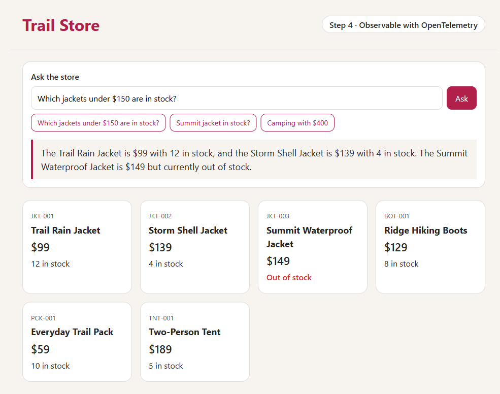

# Trail Store

Take a Java app from "runs on my laptop" to "runs on Azure, with an AI assistant you can see inside", in four small steps.

Each step is a complete Spring Boot app in its own folder, and each adds one idea to the step before it.


| Step | Folder | The one new idea | Runs |
|---|---|---|---|
| 1 | [step-1-local](step-1-local) | A plain Spring Boot store with six products | On your laptop |
| 2 | [step-2-azure](step-2-azure) | The same app on Azure Container Apps, deployed with one command | On Azure |
| 3 | [step-3-ai](step-3-ai) | An AI assistant, using Microsoft Foundry, that reads the real stock | On Azure |
| 4 | [step-4-observe](step-4-observe) | OpenTelemetry: see each request, AI call, token count, and cost | On Azure |



## Who it's for

Java developers who are new to Azure, containers, or AI. You need to know a little Java. Each step's README explains the rest.

- **Presenting?** Use the [presenter guide](docs/presenter.md) and the [workshop slides](docs/trail-store-workshop.pptx).
- **In a workshop?** Follow the [45-minute workshop](docs/workshop.md). You only need a browser.

## Words you'll meet

- **Container**: your app packed together with everything it needs to run, such as Java, so it runs the same way everywhere.
- **Bicep**: a language for describing Azure resources in a file, so you can create them again and again.
- **Managed identity**: an identity that Azure gives your app, so it can use other Azure services without passwords or keys.
- **Token**: a small piece of text, roughly three-quarters of a word. AI models are priced per token.
- **Tool**: a method in your code that the AI model can ask to run, to get facts it doesn't have.
- **Trace** and **span**: a trace is the timeline of one request. Each timed step inside it, such as one call to the model, is a span.

## Try it yourself

### Step 1, on your laptop

You need [Java 25](https://learn.microsoft.com/java/openjdk/download).

```bash
cd step-1-local
./mvnw spring-boot:run
```

On Windows, use `.\mvnw.cmd spring-boot:run`. Then open <http://localhost:8080>.

### Steps 2 to 4, on Azure

You need:

- An Azure subscription where you can create resources and assign roles, for example as an Owner.
- The [Azure Developer CLI](https://aka.ms/azd-install) (`azd`). You don't need Docker, because Azure builds the container image.

```bash
cd step-2-azure
azd auth login
azd up
```

For steps 3 and 4, run `azd up` in `step-3-ai` or `step-4-observe` instead. `azd up` asks for an environment name (for example, `trail-step2`), a subscription, and a region. After about 5 minutes, it prints the app's URL. Each step deploys into its own resource group, `rg-<environment name>`.

Steps 3 and 4 deploy the `gpt-6-luna` model, so pick a region where your subscription has quota for it. We used Sweden Central.

## What it costs

These are Azure retail prices in US dollars for Sweden Central, checked on 22 October 2026 with the [Azure Retail Prices API](https://learn.microsoft.com/rest/api/cost-management/retail-prices/azure-retail-prices).

| Service | Price | In this demo |
|---|---|---|
| Container Registry, Basic | $0.1666 a day | About $5 a month for each step you deploy. This is the main fixed cost. |
| Container Apps, Consumption | $0.000024 per vCPU-second and $0.000003 per GiB-second while running | The apps scale to zero when they're idle. A busy hour costs about $0.05 for step 2 (0.5 vCPU, 1 GiB) and about $0.11 for steps 3 and 4 (1 vCPU, 2 GiB). |
| GPT-6 Luna, Global Standard | $0.10 per 1M input tokens and $0.50 per 1M output tokens | One question uses about 540 input and 50 output tokens, so it costs about $0.00008. That's about 8 cents for 1,000 questions. |
| Log Analytics (step 4 only) | The first 5 GB a month are free, then $2.99 per GB | A demo sends a few megabytes. |

Anyone with the link can use the chat page. The model deployment accepts at most 30 requests and 30,000 tokens a minute. A question about the products is two requests, so the assistant answers about 15 questions a minute. This also caps the cost: even nonstop traffic costs at most about $0.90 an hour for the model.

## Clean up

In each step folder that you deployed, run:

```bash
azd down --purge
```

This deletes the resource group and everything in it.

## How this repo is built

Every change starts as a GitHub issue and arrives in a pull request. On each pull request, the [build workflow](.github/workflows/ci.yml) builds and tests all four steps, and checks that the Azure templates and container images build. The tests use a fake AI model, so they never call Azure.

The diagrams are [Excalidraw](https://github.com/excalidraw/excalidraw) drawings in [docs/diagrams](docs/diagrams). To change one, open its `.excalidraw` file in Excalidraw, edit it, and export it as a PNG with the same name.
