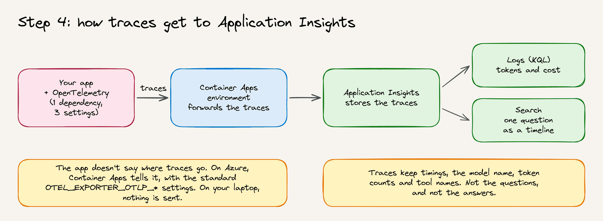

# Presenter guide (1 hour)

Everything is deployed before the event. On stage you only open files and click links. Nothing is built or deployed live.

For the 45-minute workshop, you can also present [the slides](trail-store-workshop.pptx). They follow the [workshop guide](workshop.md), and every slide has speaker notes.

## Your links

| Step | App | Code |
|---|---|---|
| 1 | <http://localhost:8080> (start it before the event) | [step-1-local](../step-1-local) |
| 2 | <https://ca-4scup3zlsthac.calmocean-83820dbb.swedencentral.azurecontainerapps.io> | [step-2-azure](../step-2-azure) |
| 3 | <https://ca-tst5kvf5kukdg.greenpebble-85b82203.swedencentral.azurecontainerapps.io> | [step-3-ai](../step-3-ai) |
| 3, bonus | <https://ca-mz7m4ugxvje6y.calmmoss-0b015d05.swedencentral.azurecontainerapps.io> | [step-3-copilot-sdk](../step-3-copilot-sdk) |
| 4 | <https://ca-n4b4dfoneyxru.ashypebble-55a62ce4.swedencentral.azurecontainerapps.io> | [step-4-observe](../step-4-observe) |

Step 4's traces are in the Application Insights resource `appi-n4b4dfoneyxru`, in the resource group `rg-trail-step4`.

These links belong to the current deployment. If you deploy a step under a new environment name, its URL changes. To see a step's URL, run `azd env get-value WEBSITE_URL` in its folder.

## Before the event

The day before:

- [ ] In a new terminal, run `java -version`. It should show version 25. If `mvnw` reports an invalid `JAVA_HOME`, set `JAVA_HOME` to your JDK 25 folder and open a new terminal.
- [ ] Sign in to the Azure CLI, which is a different tool from `azd`. Run `az login`, and check that `az account show` shows the subscription you deployed to. Then run `az extension add --name containerapp --upgrade` once.
- [ ] Sign in to the [Azure portal](https://portal.azure.com). Open `appi-n4b4dfoneyxru` > **Logs**, paste the query from the [step 4 README](../step-4-observe/README.md#see-it-in-azure), and save it.
- [ ] Rehearse the whole run of show once. While you do, take two screenshots in Application Insights: the query result, and the transaction diagnostics of one `http post /ask` request. They're your fallback if Application Insights is slow on the day.

30 minutes before:

- [ ] Keep one copy of each Azure app running, so nobody waits for an app to wake up. Otherwise, the first visit after a quiet spell takes about 30 seconds.

  ```powershell
  az containerapp update -g rg-trail-step2 -n ca-4scup3zlsthac --min-replicas 1
  az containerapp update -g rg-trail-step3 -n ca-tst5kvf5kukdg --min-replicas 1
  az containerapp update -g rg-trail-step3-copilot -n ca-mz7m4ugxvje6y --min-replicas 1
  az containerapp update -g rg-trail-step4 -n ca-n4b4dfoneyxru --min-replicas 1
  ```

- [ ] In `step-1-local`, run `.\mvnw.cmd spring-boot:run` and leave the terminal open.
- [ ] Open the app links. In steps 3 and 4, and the step 3 bonus, select **Summit jacket in stock?** once. The first answer after a restart takes about 12 seconds; after that, answers take about 3 seconds. Your step 4 warm-up question also gives the saved query something to show.
- [ ] Open these tabs: this repo on GitHub, the apps, Application Insights **Logs**, and the transaction diagnostics of your warm-up question.

After the event, run the same commands with `--min-replicas 0`, or delete everything as described in [Clean up](../README.md#clean-up).

## Run of show

The script takes 52 minutes. That leaves 8 minutes for questions, or for anything that goes wrong.

### 0:00 · Introduction (3 minutes)

- **Show:** the four-step diagram at the top of the [README](../README.md).
- **Say:** "One store, four steps. Each step is a folder, and each adds one idea: run it, ship it, add AI, and see inside it."


### 0:03 · Step 1: on my laptop (7 minutes)

- **Show:** the diagram in the [step 1 README](../step-1-local/README.md#how-it-works). Follow the numbers with your mouse.
- **Click:** [Catalog.java](../step-1-local/src/main/java/com/contoso/store/Catalog.java), [StoreController.java](../step-1-local/src/main/java/com/contoso/store/StoreController.java), [index.html](../step-1-local/src/main/resources/templates/index.html), then the localhost tab.
- **Say:** "Six products, one controller, one page. It works, but only on my laptop. Nobody else can use it, and I start it by hand."


### 0:10 · Step 2: on Azure (10 minutes)

- **Show:** the diagram in the [step 2 README](../step-2-azure/README.md#how-it-works).
- **Click:** [Dockerfile](../step-2-azure/Dockerfile), [azure.yaml](../step-2-azure/azure.yaml), [app.bicep](../step-2-azure/infra/app.bicep), then the step 2 tab.
- **Say:**
  - "The Java code didn't change. We added a Dockerfile to pack the app, `azure.yaml` to name it, and Bicep to describe the Azure resources."
  - "One command, `azd up`, created all of this in about 5 minutes."
  - "The app pulls its image with its managed identity, so there's no password. It scales to zero, so it costs nothing when nobody's using it."
- **Optional:** in GitHub, open **Actions**. "Every pull request builds and tests every step."


### 0:20 · Step 3: an AI assistant (15 minutes)

- **Show:** the diagram in the [step 3 README](../step-3-ai/README.md#how-a-question-gets-answered). "Follow the numbers: two calls to the model, and one call to our own Java code in between."
- **Click:** [InventoryTools.java](../step-3-ai/src/main/java/com/contoso/store/InventoryTools.java), [ChatController.java](../step-3-ai/src/main/java/com/contoso/store/ChatController.java), [application.properties](../step-3-ai/src/main/resources/application.properties), the Foundry part of [app.bicep](../step-3-ai/infra/app.bicep). Then, in the step 3 tab, select the three example questions.
- **Say:**
  - "The model can't see our catalog. So we give it a tool: one Java method with `@Tool`. Spring AI runs it when the model asks."
  - "There are no API keys. They're switched off in Foundry, and the app signs in with its managed identity."
  - "The Summit jacket is out of stock, and the assistant says so, then suggests jackets that are in stock. It uses real facts, not guesses."
  - "Guardrails keep the cost down: 300 characters in, 300 tokens out, and at most 30 requests a minute."
- **Optional:** ask "Write me a poem about the weather." The assistant stays on topic.
- **Then:** show the two slides on the [GitHub Copilot SDK](https://github.com/github/copilot-sdk) (2 minutes), and say:
  - "The Copilot SDK runs Copilot's agent inside your own app. You give it a goal, and it plans and calls your Java tools, step by step, until the job is done."
  - "The bonus folder, `step-3-copilot-sdk`, builds this same assistant with the SDK. Its Java releases are still labeled preview."
- **Optional:** click [Assistant.java](../step-3-copilot-sdk/src/main/java/com/contoso/store/Assistant.java), then select **Summit jacket in stock?** in the step 3 bonus tab. "Copilot's agent can run commands and edit files, so we switch all of that off. It may use our one tool, and nothing else."


### 0:35 · Step 4: see inside (12 minutes)

- **First:** in the step 4 tab, select **Summit jacket in stock?** Its trace takes one to three minutes to reach Application Insights, so ask now and show the code while you wait.
- **Show:** the first diagram in the [step 4 README](../step-4-observe/README.md#whats-new): how traces get to Application Insights.
- **Click:** [pom.xml](../step-4-observe/pom.xml), [application.properties](../step-4-observe/src/main/resources/application.properties), the Application Insights part of [app.bicep](../step-4-observe/infra/app.bicep). Then, in Application Insights, run the saved query. Finally, go to **Investigate** > **Search**, and open an `http post /ask` request.
- **Say:**
  - "A question about the products is two model calls and one tool call. Here are the tokens, and here's the cost: less than a hundredth of a cent."
  - "The traces show timings and token counts, but not what people asked."
  - "Seeing what your app does, and what it costs, is a big step toward running it in production."
- **Optional:** "Traces also showed us why the first answer was slow: 13 seconds of setup before the model was even called. With 1 vCPU instead of half, it's under 7." See [What the traces taught us](../step-4-observe/README.md#what-the-traces-taught-us).



If the portal is slow, show this diagram of a real trace instead. It's in the step 4 README too.


To show the same trace live, ask GitHub Copilot in VS Code to open the **Trail Store trace** canvas, and select **Replay the request**: the spans grow at real speed, then the trace travels to Application Insights. The canvas is in [.github/extensions/trace-explorer](../.github/extensions/trace-explorer).

### 0:47 · Wrap-up (5 minutes)

- **Show:** the four-step diagram again.
- **Say:** "Run it, ship it, add AI, see inside it. To try it yourself, run `azd up` in any step folder, and `azd down --purge` when you're done."

### 0:52 · Questions (8 minutes)

## If something goes wrong

| Problem | What to do |
|---|---|
| An Azure app is slow to open | It's waking up. Wait, or show the screenshot in that step's README. |
| The assistant says it "could not answer right now" | Say, "It fails honestly instead of making something up." Ask again a few seconds later, or show the step 3 screenshot. |
| Application Insights shows no data yet | Data takes one to three minutes to arrive. Your warm-up question is already there. Otherwise, show the trace diagram above, your rehearsal screenshots, or the results table in the [step 4 README](../step-4-observe/README.md#see-it-in-azure). |
| Step 1 won't start on your laptop | Show the step 1 screenshot, and continue with step 2. |

## Running the 45-minute workshop

In the [workshop](workshop.md), attendees ask questions in the step 3 app. At its normal capacity, the model accepts 30 requests a minute, which is about 15 questions. That's enough for you alone, but not for a room.

The day before a workshop, raise the capacity to 300, which is about 150 questions a minute:

```powershell
az cognitiveservices account deployment create -g rg-trail-step3 -n ai-tst5kvf5kukdg --deployment-name gpt-6-luna --model-name gpt-6-luna --model-version 2026-09-22 --model-format OpenAI --sku-name GlobalStandard --sku-capacity 300
```

The price per token stays the same, and the app keeps running while you change it. Even at 300, if everyone clicks in the same second, some people may see "could not answer right now". Ask them to try again a few seconds later.

After the workshop, run the same command with `--sku-capacity 30`.
