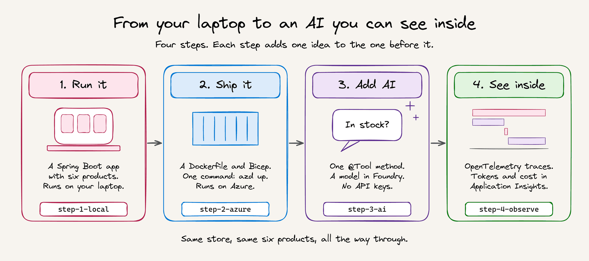
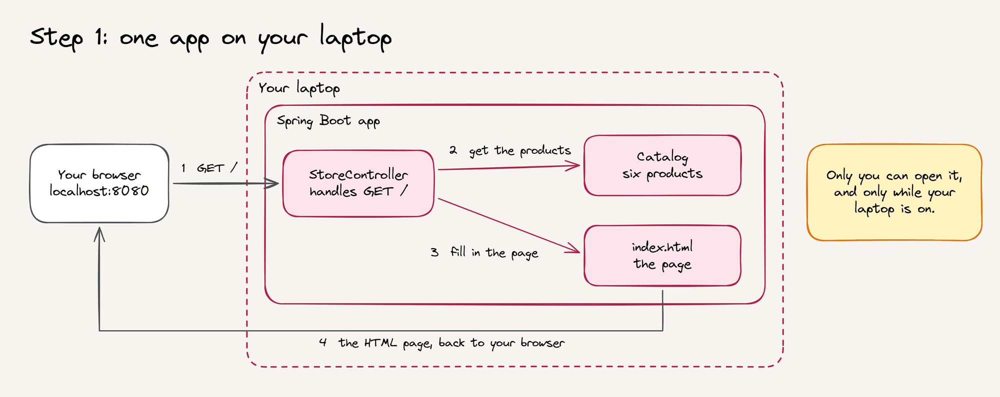
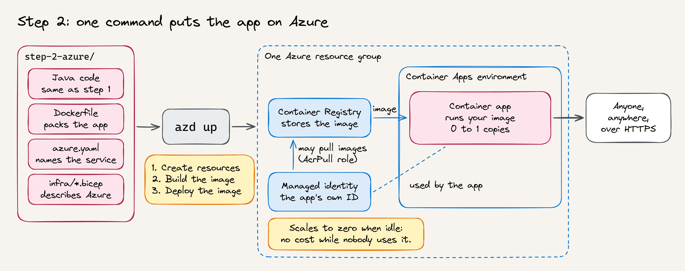
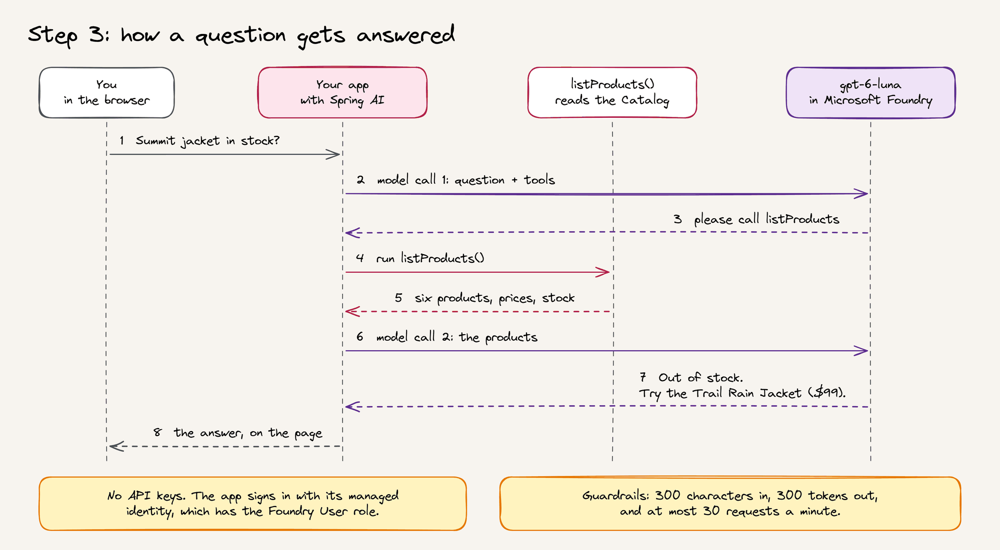
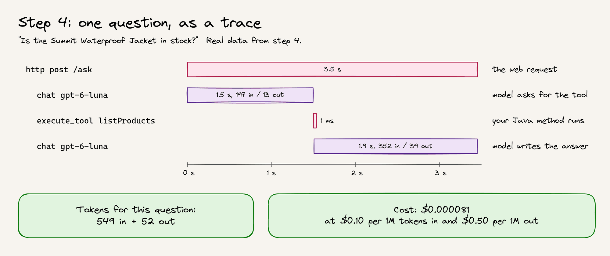

# Workshop (45 minutes)

You only need a browser. You read the code on GitHub and try the live apps. Deploying your own copy is optional homework.

Your presenter shares the links to the live apps. They look like `https://ca-....azurecontainerapps.io`. The [slides](trail-store-workshop.pptx) follow this guide.

## 1. The plan (3 minutes)

Look at the four steps below. Each step is a folder, and each adds one idea to the step before it. If a word is new to you, see [Words you'll meet](../README.md#words-youll-meet).



## 2. Step 1: a plain app (7 minutes)

Start with the diagram, and follow the numbers. Then open [step-1-local](../step-1-local), and read [Product.java](../step-1-local/src/main/java/com/contoso/store/Product.java), [Catalog.java](../step-1-local/src/main/java/com/contoso/store/Catalog.java), and [StoreController.java](../step-1-local/src/main/java/com/contoso/store/StoreController.java).



- **Find:** How many products are there? Which one is out of stock?

## 3. Step 2: on Azure (10 minutes)

Start with the diagram. Then open [step-2-azure](../step-2-azure), and read its [README](../step-2-azure/README.md), [Dockerfile](../step-2-azure/Dockerfile), and [app.bicep](../step-2-azure/infra/app.bicep). Then open the live step 2 app.



- **Find:** Which line in `app.bicep` lets the app scale to zero?
- **Find:** How does the app pull its image without a password?

## 4. Step 3: an AI assistant (12 minutes)

Start with the diagram, and follow the numbers. Then open [step-3-ai](../step-3-ai), and read [InventoryTools.java](../step-3-ai/src/main/java/com/contoso/store/InventoryTools.java) and [ChatController.java](../step-3-ai/src/main/java/com/contoso/store/ChatController.java). Then open the live step 3 app, and select one example question.



Now ask one question of your own. Pick one of these, or write your own:

1. "Do you sell kayaks?"
2. "What's the cheapest thing in stock?"
3. "Write me a poem about the weather."

The whole room shares one model. If you see "could not answer right now", wait a few seconds and try again.

- **Find:** Where does the app get permission to use the model? Is there an API key anywhere?

## 5. Step 4: see inside (8 minutes)

Open [step-4-observe](../step-4-observe), and read its [README](../step-4-observe/README.md). Your presenter shows the traces in Application Insights. This is what one real question looked like:



- **Find:** How many times does the app call the model for a question about the products? Why?
- **Find:** About how much does one question cost?

## 6. Wrap-up and questions (5 minutes)

Ask your presenter anything. To try it on your own Azure subscription, see the homework below.

## Answers

<details>
<summary>Show the answers</summary>

1. There are six products. The Summit Waterproof Jacket is out of stock: its stock is `0` in `Catalog.java`.
2. `scale: { minReplicas: 0, maxReplicas: 1 }` lets the app scale to zero. The app pulls its image with its managed identity, which has the `AcrPull` role on the registry. That's the `canPullImages` resource.
3. The `canUseModel` resource in `app.bicep` gives the app's managed identity the **Foundry User** role. There's no API key: `disableLocalAuth: true` switches keys off.
4. Twice. In the first call, the model asks for the `listProducts` tool. In the second call, it writes the answer from the tool's result. For an off-topic question, like the poem, the model usually answers in one call, because it doesn't need the tool.
5. About $0.00008, or about 8 cents for 1,000 questions.

</details>

## Homework: deploy your own

You need an Azure subscription where you can create resources and assign roles, and the [Azure Developer CLI](https://aka.ms/azd-install). In any step folder from 2 to 4, run:

```bash
azd auth login
azd up
```

When you're done, run `azd down --purge` in the same folder to delete everything.
