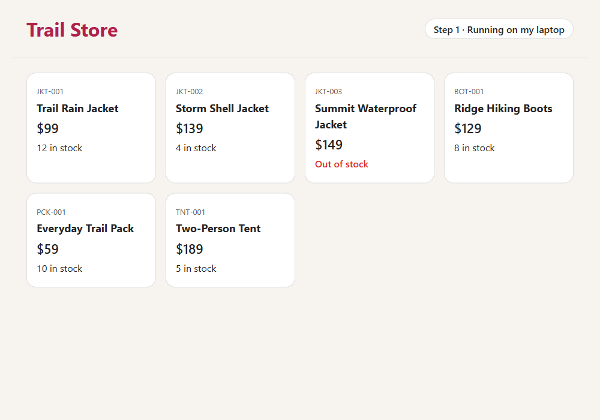

# Step 1 · A plain Spring Boot app

This is where many apps start: one Spring Boot app that runs on a developer's laptop.



## How it works

Follow the numbers.


## What's inside

| File | What it does |
|---|---|
| [Product.java](src/main/java/com/contoso/store/Product.java) | One product: SKU, name, price in US dollars, and units in stock. It's a Java `record`. |
| [Catalog.java](src/main/java/com/contoso/store/Catalog.java) | The six products the store sells. |
| [StoreController.java](src/main/java/com/contoso/store/StoreController.java) | Handles `GET /` and passes the products to the page. |
| [index.html](src/main/resources/templates/index.html) | The page. It's a [Thymeleaf](https://www.thymeleaf.org/) template. |
| [StoreApplicationTests.java](src/test/java/com/contoso/store/StoreApplicationTests.java) | Checks that the page shows the products. |

## Run it

You need [Java 25](https://learn.microsoft.com/java/openjdk/download). The Maven wrapper (`mvnw`) downloads Maven for you.

```bash
cd step-1-local
./mvnw spring-boot:run
```

On Windows, use `.\mvnw.cmd spring-boot:run`.

Open <http://localhost:8080>. You see six products, and the Summit Waterproof Jacket is out of stock. Press Ctrl+C to stop the app.

To run the test, use `./mvnw verify`. On Windows, use `.\mvnw.cmd verify`.

## Why it isn't cloud native yet

- Only you can open it, and only while your laptop is on.
- You build, start, and update it by hand.
- It works because your laptop happens to have Java 25. Nothing describes what it needs to run.

**Next:** [step 2](../step-2-azure) runs the same app on Azure.
