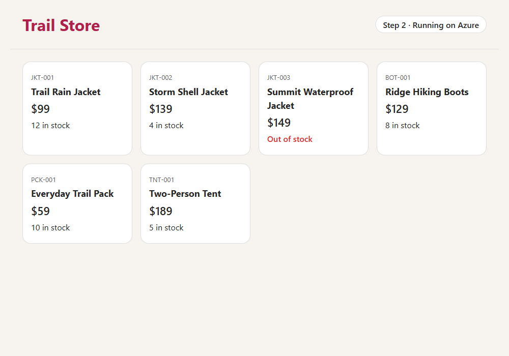

# Step 2 · The same app on Azure

The Java code is the same as in step 1. Only the label at the top of the page changed. What's new is everything needed to run the app on Azure.



## How it works


## What's new

| File | What it does |
|---|---|
| [Dockerfile](Dockerfile) | Builds the app and packs it, together with Java, into a container image. |
| [azure.yaml](azure.yaml) | Tells the Azure Developer CLI (`azd`) that there's one service, `web`, and it runs on Azure Container Apps. |
| [infra/main.bicep](infra/main.bicep) | Creates a resource group to hold everything. |
| [infra/app.bicep](infra/app.bicep) | Creates the Azure resources in the next table. |

| Azure resource | Why it's there |
|---|---|
| Container registry | Stores the app's container image. |
| Managed identity | The app's own identity in Azure. The app uses it to pull its image, with no password. |
| Container Apps environment | The place where container apps run. |
| Container app | Runs the image at a public HTTPS address. It scales to zero when nobody's using it, and never runs more than one copy. |

## Deploy it

You need:

- An Azure subscription where you can create resources and assign roles, for example as an Owner.
- The [Azure Developer CLI](https://aka.ms/azd-install). You don't need Docker, because the image is built in Azure.

```bash
cd step-2-azure
azd auth login
azd up
```

Enter an environment name, such as `trail-step2`, and then pick a subscription and a region. After about 5 minutes, `azd` prints the app's URL.

The app scales to zero when nobody's using it, so the first visit after a quiet spell can take up to a minute.

One `azd up` command does three jobs:

1. Creates the Azure resources described in `infra/`.
2. Builds the container image from the `Dockerfile`, in Azure.
3. Deploys the image to the container app.

## Test it

The tests are the same as in step 1, and they don't need Azure. Run `./mvnw verify`. On Windows, run `.\mvnw.cmd verify`.

## Cost

The container registry costs about \$0.17 a day. The app costs nothing while it's scaled to zero. For the details, see [What it costs](../README.md#what-it-costs).

## Clean up

```bash
azd down --purge
```

**Next:** [step 3](../step-3-ai) adds an AI assistant.
