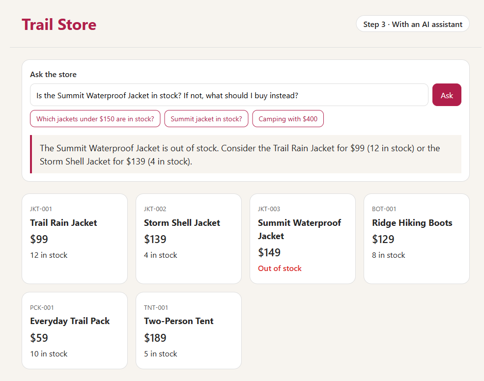

# Step 3 · An AI assistant that knows the stock

The store gets an assistant. It answers with the real prices and stock, because it can call a Java method that reads the catalog.



## What's new

| File | What it does |
|---|---|
| [pom.xml](pom.xml) | Adds Spring AI, and Azure Identity so the app can sign in to Azure without a key. |
| [InventoryTools.java](src/main/java/com/contoso/store/InventoryTools.java) | One `@Tool` method, `listProducts`, that the AI model may call. It reads the same `Catalog` as the web page. |
| [ChatController.java](src/main/java/com/contoso/store/ChatController.java) | Handles `POST /ask`. It sends the question and the tool to the model, then shows the answer. |
| [application.properties](src/main/resources/application.properties) | Points Spring AI at the model in Microsoft Foundry. Foundry serves the model through the OpenAI API, so the settings start with `spring.ai.openai`. |
| [index.html](src/main/resources/templates/index.html) | Adds a question box and three example questions. |
| [infra/app.bicep](infra/app.bicep) | Adds Microsoft Foundry, the `gpt-6-luna` model, and permission for the app's identity to use the model. It also gives the app 1 vCPU and 2 GiB of memory, because the AI library needs the extra CPU to get ready quickly. |

## How a question gets answered


Follow the numbers in the diagram:

- **1:** You ask, "Is the Summit Waterproof Jacket in stock?"
- **2:** Spring AI sends your question to the model, and tells it that a `listProducts` tool exists.
- **3 to 5:** The model asks for `listProducts`. Spring AI runs the Java method and gets the six products.
- **6 and 7:** Spring AI sends the products to the model, and the model answers from those facts: the Summit jacket is out of stock, but two other jackets are in stock.
- **8:** The answer appears on the page.

So a question about the products usually means two calls to the model. The model decides whether it needs the tool. For an off-topic question, such as "Write me a poem", it usually declines in one call, without the tool.

## No keys

API keys are switched off on the Foundry resource (`disableLocalAuth: true`). The app signs in with its managed identity, which has the **Foundry User** role on that resource. There's no secret to leak or rotate.

## Guardrails

- Questions can be up to 300 characters long, and answers up to 300 tokens.
- The model deployment accepts at most 30 requests and 30,000 tokens a minute. That's about 15 questions a minute, and it also caps what the model can cost.
- If the model call fails, the page says so instead of guessing, and the app logs the error.

## Deploy it

You need the same tools as in [step 2](../step-2-azure/README.md#deploy-it).

```bash
cd step-3-ai
azd auth login
azd up
```

Use a new environment name, such as `trail-step3`. Pick a region where your subscription has quota for `gpt-6-luna` (Global Standard). We used Sweden Central.

The app scales to zero when nobody's using it. The first visit after a quiet spell takes about 30 seconds, while Azure starts the app. The first question then takes about 12 seconds, while the app signs in to Foundry and loads its AI library. After that, answers take about 3 seconds.

## Test it

This step needs Azure to run. On your laptop, the `AZURE_OPENAI_ENDPOINT` setting is missing, so the app stops at startup with `Illegal character in path at index 1: ${AZURE_OPENAI_ENDPOINT}`.

The tests don't need Azure, because they use a fake model. Run `./mvnw verify`. On Windows, run `.\mvnw.cmd verify`.

## Cost

Models are priced per token. A token is a small piece of text, roughly three-quarters of a word. A question costs about \$0.00008, or about 8 cents for 1,000 questions. The container registry costs about \$0.17 a day. For the details, see [What it costs](../README.md#what-it-costs).

## Clean up

```bash
azd down --purge
```

**Next:** [step 4](../step-4-observe) shows what happens inside each answer.
