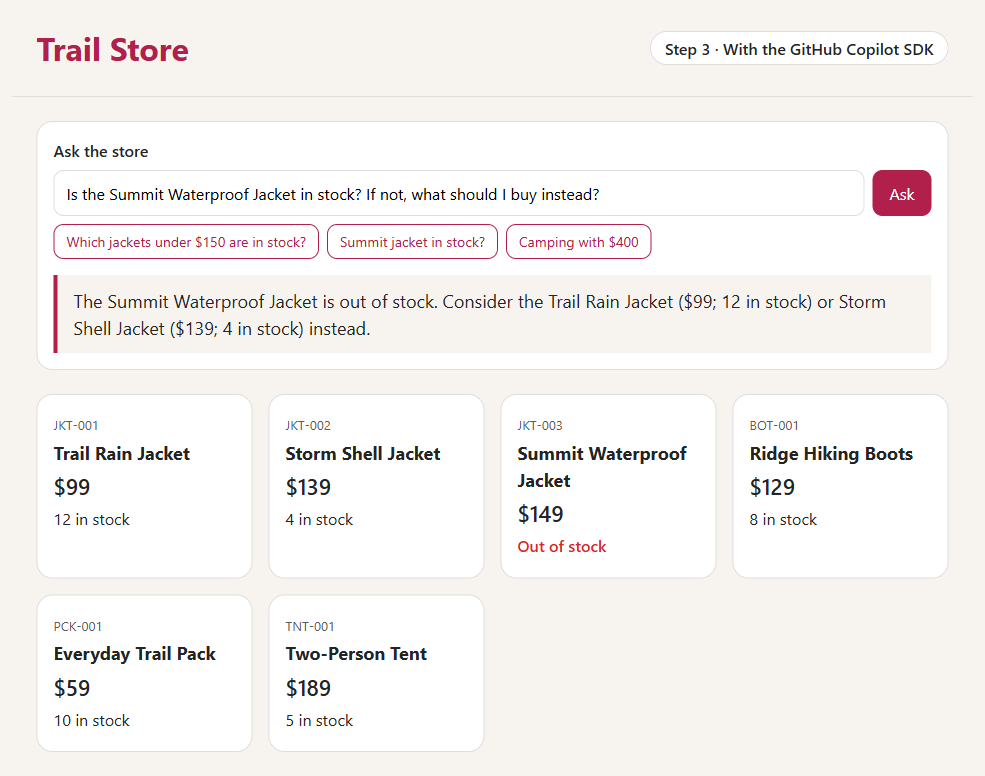

# Step 3, going further · The same assistant, with the GitHub Copilot SDK

This is [step 3](../step-3-ai) with one change: the assistant runs on the [GitHub Copilot SDK](https://github.com/github/copilot-sdk) instead of Spring AI. The SDK puts Copilot's **agent** inside your app: an AI that calls your Java tools, one after another, until it can answer.

The store, the six products, Microsoft Foundry, and the managed identity are the same as in step 3.

> The Copilot SDK for Java is still in preview. Two parts we use, `@CopilotTool` and the managed identity sign-in, are marked experimental, so they may change.



## What's new

| File | What it does |
|---|---|
| [pom.xml](pom.xml) | Swaps Spring AI for the Copilot SDK and Copilot's agent runtime for Linux. It also runs the SDK's annotation processor, which turns `@CopilotTool` methods into tools, and allows the SDK's experimental parts. |
| [InventoryTools.java](src/main/java/com/contoso/store/InventoryTools.java) | The same `listProducts` method, now marked `@CopilotTool`. The agent knows it as `list_products`. |
| [Assistant.java](src/main/java/com/contoso/store/Assistant.java) | New, and the only file that uses the SDK. It starts Copilot's agent with our tool and our model in Foundry, and asks it each question. |
| [ChatController.java](src/main/java/com/contoso/store/ChatController.java) | Handles `POST /ask` as before, but hands the question to `Assistant`. |

The Azure resources in [infra/app.bicep](infra/app.bicep) are the same as in step 3.

## How a question gets answered

1. You ask, "Is the Summit Waterproof Jacket in stock?"
2. `Assistant` opens a new Copilot session and sends your question. The first question also starts Copilot's agent runtime, which runs next to the app, in the same container.
3. The agent sends your question to the model in Foundry, and tells it that a `list_products` tool exists.
4. The model asks for `list_products`. The SDK runs your Java method, which reads the catalog.
5. The agent sends the products to the model, and the model answers from those facts.
6. `Assistant` deletes the session, and the answer appears on the page.

As in step 3, a question about the products takes two calls to the model, and an off-topic question usually takes one. With more tools, the agent would keep going: it can call several tools, one after another, until the job is done.

## Locked down

Out of the box, Copilot's agent can read and write files and run commands. A public web page must never allow that, so `Assistant` switches everything off, then allows only what the store needs:

- **Empty mode** (`CopilotClientMode.EMPTY`) starts with all of Copilot's built-in tools switched off.
- **One tool:** each session may use `custom:list_products`, and nothing else.
- **Our own instructions** replace Copilot's coding instructions, so the agent only helps with the store.
- **No questions kept:** each question gets its own session, and `Assistant` deletes it afterwards, even when something fails.

Ask it to run a command or read a file, and it declines: it has no tool for either. Its first model call for each question uses only about 140 input tokens, for the instructions, the question, and the one tool.

## No keys

As in step 3, API keys are switched off in Foundry, and the app signs in with its managed identity, which has the **Foundry User** role. `Assistant` gets a token from Azure Identity's `DefaultAzureCredential`, and the SDK asks for a fresh one before each call to the model.

## Guardrails

- Questions can be up to 300 characters long, and answers up to 300 tokens.
- The model deployment accepts at most 30 requests and 30,000 tokens a minute. That's about 15 questions a minute, and it also caps what the model can cost.
- If anything fails, the page says so instead of guessing, and the app logs the error. If there's no answer after 60 seconds, the app stops waiting and says so.

## Deploy it

You need the same tools as in [step 2](../step-2-azure/README.md#deploy-it).

```bash
cd step-3-copilot-sdk
azd auth login
azd up
```

Use a new environment name, such as `trail-step3-copilot`. As in step 3, pick a region where your subscription has quota for `gpt-6-luna`. We used Sweden Central.

The app scales to zero when nobody's using it. The first visit after a quiet spell takes about 20 seconds, while Azure starts the app. The first question then takes about 12 seconds, while the app unpacks and starts Copilot's agent runtime and signs in to Foundry. After that, answers take about 3 seconds.

## Test it

This step needs Azure to run. On your laptop, the `AZURE_OPENAI_ENDPOINT` setting is missing, so the app stops at startup with `Could not resolve placeholder 'AZURE_OPENAI_ENDPOINT'`. The app also only includes Copilot's agent runtime for Linux, which is what it runs on in Azure.

The tests don't need Azure, because they use a fake assistant, so they never start Copilot's agent runtime. One test checks that `@CopilotTool` turned `listProducts` into the `list_products` tool. Run `./mvnw verify`. On Windows, run `.\mvnw.cmd verify`.

## Cost

About the same as step 3. A question about the products uses about 430 input and 100 output tokens, so it costs about $0.0001, or about 10 cents for 1,000 questions. The container registry costs about $0.17 a day. For the details, see [What it costs](../README.md#what-it-costs).

## Clean up

```bash
azd down --purge
```

**Next:** [step 4](../step-4-observe) shows what happens inside each answer, using step 3's Spring AI version.
