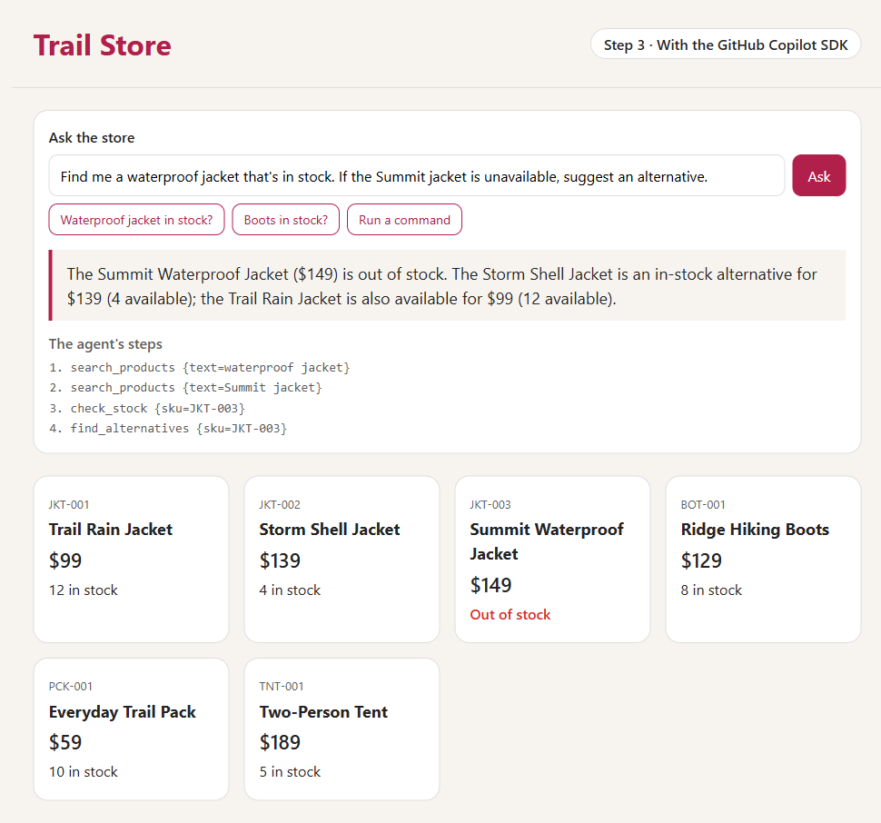
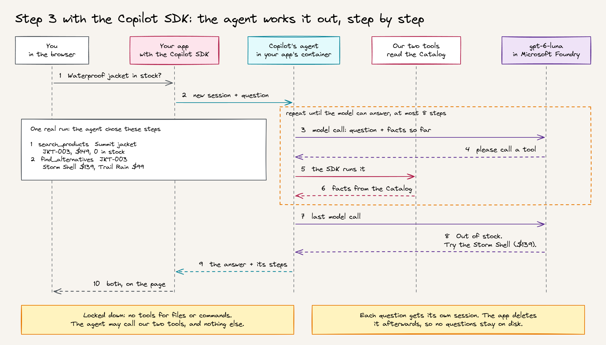

# Step 3, going further · An agent that works it out, with the GitHub Copilot SDK

In [step 3](../step-3-ai), the model gets one tool that lists every product, and it answers in one go. Here, the assistant runs on the [GitHub Copilot SDK](https://github.com/github/copilot-sdk), which puts Copilot's **agent** inside your app. The agent gets three small tools instead of one, and it decides which to call, one step at a time, until it can answer. The page shows each step.

The store, the six products, Microsoft Foundry, and the managed identity are the same as in step 3.

> The Copilot SDK for Java is still in preview. Two parts we use, `@CopilotTool` and the managed identity sign-in, are marked experimental, so they may change.



## Try it

Select **Waterproof jacket in stock?** It asks:

> Find me a waterproof jacket that's in stock. If the Summit jacket is unavailable, suggest an alternative.

The agent searches for the Summit jacket, checks its stock, finds that it's sold out, and asks for alternatives. Under the answer, the page lists the steps it took. **Boots in stock?** takes only two steps, because the boots are in stock, so the agent doesn't look for alternatives. **Run a command** takes none: the agent has no tool for it, so it declines.

## What's new

| File | What it does |
|---|---|
| [pom.xml](pom.xml) | Swaps Spring AI for the Copilot SDK and Copilot's agent runtime for Linux. It also runs the SDK's annotation processor, which turns `@CopilotTool` methods into tools, and allows the SDK's experimental parts. |
| [InventoryTools.java](src/main/java/com/contoso/store/InventoryTools.java) | Three `@CopilotTool` methods, each doing one small job: `search_products` finds products by name, `check_stock` reads one product's stock, and `find_alternatives` suggests in-stock products of the same kind. They only read the `Catalog`. |
| [Assistant.java](src/main/java/com/contoso/store/Assistant.java) | New, and the only file that uses the SDK. It starts Copilot's agent with our tools and our model in Foundry, asks it each question, and notes each tool the agent calls. If the agent needs more than 8 steps, it stops the agent. |
| [Answer.java](src/main/java/com/contoso/store/Answer.java) | The answer, and the agent's steps, in order. |
| [ChatController.java](src/main/java/com/contoso/store/ChatController.java) | Handles `POST /ask` as before, but hands the question to `Assistant`, and puts the steps on the page. If `Assistant` stopped the agent, the page says why. |
| [index.html](src/main/resources/templates/index.html) | Three new example questions, and the list of the agent's steps under the answer. |

The Azure resources in [infra/app.bicep](infra/app.bicep) are the same as in step 3.

## How a question gets answered



Follow the numbers in the diagram:

- **1:** You ask, "Find me a waterproof jacket that's in stock."
- **2:** `Assistant` opens a new Copilot session and sends your question. The first question also starts Copilot's agent runtime, which runs next to the app, in the same container.
- **3 to 6, repeated:** The agent sends the question, and the facts so far, to the model in Foundry. The model asks for one of the three tools, and the SDK runs that Java method. This repeats until the model has the facts it needs.
- **7 and 8:** The model answers from those facts.
- **9 and 10:** The agent hands back the answer, and `Assistant` hands back the tools it called. `Assistant` deletes the session, and both appear on the page.

Nobody wrote "search, then check stock, then find alternatives" in the code. The model picks each step from the tools' descriptions and the facts so far, so the steps can differ a little between runs: sometimes it searches twice, once for "Summit jacket" and once for "waterproof jacket". That's the difference from step 3, where one tool hands over the whole catalog at once.

## Locked down

Out of the box, Copilot's agent can read and write files and run commands. A public web page must never allow that, so `Assistant` switches everything off, then allows only what the store needs:

- **Empty mode** (`CopilotClientMode.EMPTY`) starts with all of Copilot's built-in tools switched off.
- **Our tools only:** each session may use `custom:*`, which means the three tools in `InventoryTools`, and nothing else. They only read the catalog.
- **Our own instructions** replace Copilot's coding instructions, so the agent only helps with the store.
- **No questions kept:** each question gets its own session, and `Assistant` deletes it afterwards, even when something fails.

Select **Run a command**, and the agent declines: it has no tool for files or commands, so the page shows no steps.

## No keys

As in step 3, API keys are switched off in Foundry, and the app signs in with its managed identity, which has the **Foundry User** role. `Assistant` gets a token from Azure Identity's `DefaultAzureCredential`, and the SDK asks for a fresh one before each call to the model.

## Guardrails

- Questions can be up to 300 characters long, and answers up to 300 tokens.
- The model deployment accepts at most 30 requests and 30,000 tokens a minute. The waterproof jacket question takes about four model calls, so that's about 7 such questions a minute. It also caps what the model can cost.
- Each step costs a model call, so the agent may take at most 8 steps for one question. If it needs more, for example to check every product and find alternatives for each, `Assistant` stops it, and the page asks you to ask about fewer products at a time. That stops one question from using up the model's limit for everyone: a stopped question makes at most 9 model calls.
- If anything fails, the page says so instead of guessing, and the app logs the error. If there's no answer after 60 seconds, the app stops waiting and says so.

## Deploy it

You need the same tools as in [step 2](../step-2-azure/README.md#deploy-it).

```bash
cd step-3-copilot-sdk
azd auth login
azd up
```

Use a new environment name, such as `trail-step3-copilot`. As in step 3, pick a region where your subscription has quota for `gpt-6-luna`. We used Sweden Central.

The app scales to zero when nobody's using it. The first visit after a quiet spell takes about 20 seconds, while Azure starts the app. The first question then takes about 15 seconds, while the app unpacks and starts Copilot's agent runtime and signs in to Foundry. After that, the waterproof jacket question takes about 5 seconds, because the agent takes several steps.

## Test it

This step needs Azure to run. On your laptop, the `AZURE_OPENAI_ENDPOINT` setting is missing, so the app stops at startup with `Could not resolve placeholder 'AZURE_OPENAI_ENDPOINT'`. The app also only includes Copilot's agent runtime for Linux, which is what it runs on in Azure.

The tests don't need Azure: they use a fake assistant, so they never start Copilot's agent runtime. They call each of the three tools on the real catalog, check that `@CopilotTool` turned the methods into the `search_products`, `check_stock`, and `find_alternatives` tools, and check what the page says when the assistant fails or needs too many steps. Run `./mvnw verify`. On Windows, run `.\mvnw.cmd verify`.

## Cost

Taking more steps costs more than step 3, but it's still small. The waterproof jacket question makes about four model calls, which use about 1,440 input and 120 output tokens in total. That's about \$0.0002, or about 20 cents for 1,000 questions. Each call sends the conversation so far, so every extra step adds input tokens. The container registry costs about \$0.17 a day. For the details, see [What it costs](../README.md#what-it-costs).

## Clean up

```bash
azd down --purge
```

**Next:** [step 4](../step-4-observe) shows what happens inside each answer, using step 3's Spring AI version.
